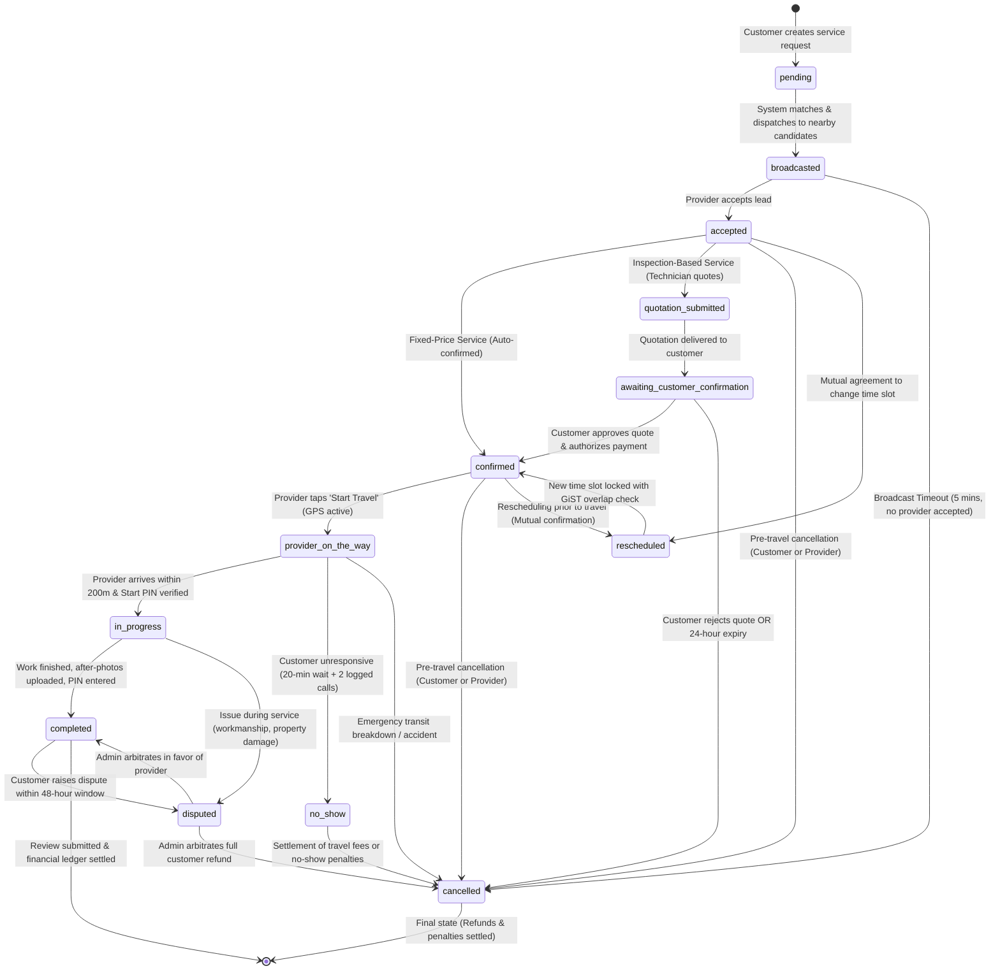

# KAAMLY PLATFORM – COMPLETE 13-STATE BOOKING LIFECYCLE & SCHEDULING ENGINE

## 1. The 13 Canonical Booking States

The platform enforces 13 deterministic, unabbreviated lifecycle states:

| # | State Slug | Official Display Name | Purpose & Definition |
| :-: | :--- | :--- | :--- |
| **1** | `pending` | **Pending Dispatch** | Customer submitted service request; system is validating coordinates and matching candidates. |
| **2** | `broadcasted` | **Request Broadcasted** | Request dispatched to candidate providers; 5-minute countdown active. |
| **3** | `accepted` | **Accepted by Provider** | A technician accepted the job. If fixed-price, moves immediately to `confirmed`; if inspection-based, moves to quotation phase. |
| **4** | `quotation_submitted` | **Quotation Submitted** | Technician inspected site/problem and submitted an itemized scope & price quotation. |
| **5** | `awaiting_customer_confirmation` | **Awaiting Customer Confirmation** | Quotation delivered to customer; 24-hour review timer running. |
| **6** | `confirmed` | **Confirmed & Scheduled** | Work scope and price locked; appointment slot reserved with travel buffer. |
| **7** | `provider_on_the_way` | **Provider En Route** | Technician tapped "Start Travel"; real-time GPS tracking stream broadcasting to customer. |
| **8** | `in_progress` | **Service In Progress** | Technician arrived on site; customer's 6-digit start PIN verified; labor active. |
| **9** | `completed` | **Service Completed** | Work finished, photo proof uploaded, customer signed off; financial ledger posted. |
| **10**| `cancelled` | **Booking Cancelled** | Order terminated prior to completion (with applicable refund or penalty). |
| **11**| `disputed` | **Under Formal Dispute** | Complaint/damage claim filed; payout held in escrow pending admin arbitration. |
| **12**| `rescheduled` | **Rescheduled** | Appointment date/time updated upon mutual agreement before transit. |
| **13**| `no_show` | **No-Show Recorded** | Either customer or technician failed to appear at the job site. |

---

## 2. Complete State Transition Matrix



---

## 3. Exhaustive Transition Matrix: Actor, Validation, Timeout & Financial Impact

| Current State | Target State | Permitted Actor | Validation Rules & Preconditions | Timeout / Expiry | Payment & Financial Ledger Impact |
| :--- | :--- | :--- | :--- | :--- | :--- |
| `pending` | `broadcasted` | **System** | Valid customer address; $\ge 1$ online verified provider within travel radius. | 30 seconds | None. |
| `broadcasted` | `accepted` | **Provider** | Provider is online; no GiST slot conflict; wallet balance $\ge -\text{PKR } 2,000$. | **5 minutes** | Cancels broadcast to other candidate providers. |
| `broadcasted` | `cancelled` | **System** | No provider accepted within 5-minute broadcast window. | After 5 mins | 100% full refund if prepaid online. |
| `accepted` | `confirmed` | **System** | Service is `fixed` or `hourly` pricing; price already approved. | Immediate | For online: Escrow hold confirmed. For COD: Cash collection expected on site. |
| `accepted` | `quotation_submitted` | **Provider** | Service is `inspection_based` or `quotation_required`. Quote has $\ge 1$ line item. | - | Quotation record created (`version=1`). |
| `quotation_submitted` | `awaiting_customer_confirmation` | **System** | Push notification and SMS alert delivered to customer. | **24 hours** | None. |
| `awaiting_customer_confirmation` | `confirmed` | **Customer** | Customer approves price & scope; payment authorized. | Within 24 hrs | Quoted total becomes locked snapshot on `bookings`. Escrow hold updated. |
| `awaiting_customer_confirmation` | `cancelled` | **Customer / System** | Customer declines quote OR 24-hour expiry elapses. | After 24 hrs | Inspection fee (PKR 500) charged if inspection was performed; credited to provider. |
| `accepted` or `confirmed` | `rescheduled` | **Customer / Provider** | Request made before provider enters `provider_on_the_way`. Counterpart approves. | - | Database verifies no GiST overlap on new slot for provider. |
| `rescheduled` | `confirmed` | **System** | New appointment slot locked in `bookings`. | Immediate | None. |
| `confirmed` | `provider_on_the_way` | **Provider** | Within 2 hours of appointment start; provider device GPS location fresh. | - | Real-time tracking channel opened (`private-booking.{id}.tracking`). |
| `provider_on_the_way` | `in_progress` | **Customer & Provider** | Provider GPS within 200m of customer address; customer provides 6-digit Start PIN. | - | PIN verified; `started_at` recorded. Tracking channel closed. |
| `provider_on_the_way` | `no_show` | **Provider** | Provider on site for $\ge 20$ minutes; $\ge 2$ in-app calls attempted with call logs. | 20 mins wait | Customer charged PKR 500 travel fee; credited to provider wallet. |
| `confirmed` or `provider_on_the_way` | `no_show` | **Customer** | Provider fails to arrive within 45 minutes of scheduled window without notice. | 45 mins wait | 100% full refund to customer; PKR 500 penalty debited to provider receivable. |
| `in_progress` | `completed` | **Provider** | $\ge 1$ "After-service" photo uploaded; completion confirmed by customer PIN. | - | Double-entry ledger posted (COD: commission receivable debited; Online: escrow released). |
| `in_progress` | `disputed` | **Customer / Provider** | Damage, scope violation, or unauthorized charge reported; evidence uploaded. | - | Escrow payout frozen; assigned to Admin dispute queue. |
| `completed` | `disputed` | **Customer** | Filed within 48-hour warranty window; formal dispute reason selected. | **48 hours** | Provider payout held in settlement queue. |
| `disputed` | `completed` | **Admin Arbitrator** | Admin reviews evidence and finds in favor of provider. | - | Escrow funds released to provider; dispute closed. |
| `disputed` | `cancelled` | **Admin Arbitrator** | Admin finds in favor of customer (poor quality/damage). | - | Escrow refunded to customer; penalty assessed to provider if damages verified. |
| Any pre-transit | `cancelled` | **Customer** | Customer cancels $> 2$ hours before slot: 0 fee. $1-2$ hours: PKR 200 fee. | - | Refund issued net of cancellation fee. |
| Any post-accept | `cancelled` | **Provider** | Provider cancels after accepting without verified emergency. | - | PKR 300 penalty debited to provider; acceptance score penalized. |

---

## 4. Scheduling & Double-Booking Prevention

### A. The Hybrid Scheduling Model
Kaamly combines user-friendly **Canonical Time Slots** on the frontend with **Exact Range-Based GiST Exclusion Constraints** on the backend:

1. **Canonical Time Slots (Customer UI)**:
   * Slot 1: `09:00 - 11:00` (Morning A)
   * *Buffer*: `11:00 - 11:30` (30-min Travel / Rest Buffer)
   * Slot 2: `11:30 - 13:30` (Morning B)
   * *Buffer*: `13:30 - 14:00` (Lunch / Travel Buffer)
   * Slot 3: `14:00 - 16:00` (Afternoon A)
   * *Buffer*: `16:00 - 16:30` (30-min Travel Buffer)
   * Slot 4: `16:30 - 18:30` (Afternoon B)
   * *Buffer*: `18:30 - 19:00` (30-min Travel Buffer)
   * Slot 5: `19:00 - 21:00` (Evening)

2. **Variable Durations & Buffer Handling**:
   * Services have an `estimated_duration_minutes` (e.g. 60 min, 120 min, 240 min).
   * When scheduled, `scheduled_start_at` is set to the appointment start time.
   * `scheduled_end_at` is automatically calculated as:
     $$\text{scheduled\_end\_at} = \text{scheduled\_start\_at} + \text{estimated\_duration\_minutes} + \text{30 minutes travel buffer}$$

3. **Database-Level GiST Exclusion Constraint**:
   [`bookings`](file:///d:/Study/code/Kaamly/database/schema.sql#L326) defines a PostgreSQL range exclusion constraint using `btree_gist`:
   ```sql
   CONSTRAINT ex_bookings_no_overlap
       EXCLUDE USING GIST (
           provider_profile_id WITH =,
           scheduled_range WITH &&
       )
       WHERE (status IN ('accepted', 'confirmed', 'provider_on_the_way', 'in_progress'))
   ```
   * **Absolute Invariant**: PostgreSQL mathematically blocks any transaction that attempts to book an overlapping `[start, end)` time window for the same provider across active statuses. Double-booking is impossible at the database storage engine layer.
