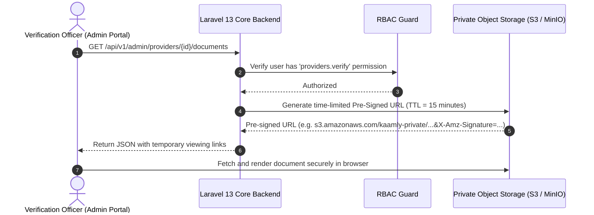

# KAAMLY PLATFORM – SECURITY, ENCRYPTION & GOVERNANCE CONTROLS

## 1. Sensitive Data Encryption Standards

To comply with enterprise security benchmarks and data protection standards, personally identifiable information (PII) and banking secrets are encrypted at the application layer prior to database persistence.

### Encrypted Fields & Cryptographic Algorithms:
* **Algorithm**: `AES-256-GCM` with authenticated data headers (via Laravel `Crypt` / OpenSSL).
* **Encrypted Columns**:
  * `provider_bank_accounts.account_number_encrypted`
  * `provider_bank_accounts.iban_encrypted`
  * `provider_documents.document_number` (CNIC, tax IDs, passport numbers)
  * `customer_profiles.emergency_contact_phone`
* **Key Rotation Protocol**:
  * Encryption uses `APP_KEY`. Laravel's multi-key support (`APP_PREVIOUS_KEYS`) allows graceful cryptographic key rotation without database downtime.
  * In the database, fields are stored as `base64(iv . ciphertext . tag)` payload strings.

---

## 2. Private Document Storage & Pre-Signed Access

KYC documents (CNIC scans, police character certificates, trade diplomas, proof of work) must never be exposed via public URLs.



* **Bucket Configuration**: Public Read is permanently disabled on S3/MinIO.
* **Access Rules**: Direct links expire within **15 minutes**.
* **Audit Trail**: Every request to view or generate a document pre-signed URL logs a `document.viewed` record in `audit_logs`.

---

## 3. Role-Based Access Control (RBAC) Matrix

The platform implements unified authentication with role-based policies:

| Permission Name | Super Admin | Operations Manager | Verification Officer | Finance Officer | Support Agent |
| :--- | :---: | :---: | :---: | :---: | :---: |
| `users.view_all` | :white_check_mark: | :white_check_mark: | :white_check_mark: | :white_check_mark: | :white_check_mark: |
| `providers.verify` | :white_check_mark: | :white_check_mark: | :white_check_mark: | :x: | :x: |
| `providers.suspend` | :white_check_mark: | :white_check_mark: | :x: | :x: | :x: |
| `pricing.approve` | :white_check_mark: | :white_check_mark: | :x: | :x: | :x: |
| `services.manage` | :white_check_mark: | :white_check_mark: | :x: | :x: | :x: |
| `commissions.manage` | :white_check_mark: | :white_check_mark: | :x: | :white_check_mark: | :x: |
| `settlements.execute` | :white_check_mark: | :x: | :x: | :white_check_mark: | :x: |
| `ledger.adjust` | :white_check_mark: (Maker-Checker)| :x: | :x: | :white_check_mark: (Checker)| :x: |
| `disputes.arbitrate`| :white_check_mark: | :white_check_mark: | :x: | :x: | :white_check_mark: |
| `chats.monitor` | :white_check_mark: | :white_check_mark: | :x: | :x: | :white_check_mark: |
| `audit_logs.view` | :white_check_mark: | :x: | :x: | :x: | :x: |

---

## 4. Immutable Audit Logging Protocol

Any write operation affecting security, provider onboarding, pricing, or financial balances generates an immutable entry in `audit_logs`:

```json
{
  "id": "9b1deb4d-3b7d-4bad-9bdd-2b0d7b3dcb6d",
  "user_id": "4a7e937d-b541-4557-b08e-dc0f35368680",
  "action": "price.approved",
  "auditable_type": "App\\Models\\ProviderServicePrice",
  "auditable_id": "78328190-67c4-42b7-a362-e64e9a8f4c28",
  "old_values": {
    "approved_price": null,
    "approval_status": "pending",
    "is_current_active": false
  },
  "new_values": {
    "approved_price": "4500.00",
    "approval_status": "approved",
    "is_current_active": true
  },
  "ip_address": "192.168.1.104",
  "user_agent": "Mozilla/5.0 (Windows NT 10.0; Win64; x64) AppleWebKit/537.36",
  "created_at": "2026-11-16T10:45:00Z"
}
```

* **Database Level Security**: The application PostgreSQL database role has `INSERT` and `SELECT` rights on `audit_logs`. `UPDATE` and `DELETE` grants are permanently withheld, making logs tamper-proof even in the event of administrative compromise.

---

## 5. Financial Adjustment & Dual-Authorization (Maker-Checker)

Direct adjustments to provider or customer wallet balances are impossible under the double-entry architecture. Any manual correction must proceed via a balanced `ledger_transaction`:

1. **Maker Phase**: A Finance Officer drafts a manual adjustment transaction in `ledger_transactions` (status = `draft`), specifying:
   * Target user ledger account
   * Counterpart system account (e.g., `5020 Platform Operational Goodwill Expense`)
   * Supporting reason, dispute ID, or bank reference ticket
2. **Checker Phase**: For adjustments exceeding **PKR 10,000**, a second user with the `ledger.adjust` authorization (Super Admin or Head of Finance) must review and approve the draft before it can be marked as `posted`.
3. **Execution**: The database transaction verifies $\sum \text{Debit} = \sum \text{Credit}$, marks the transaction as `posted`, and permanently locks the entries.
