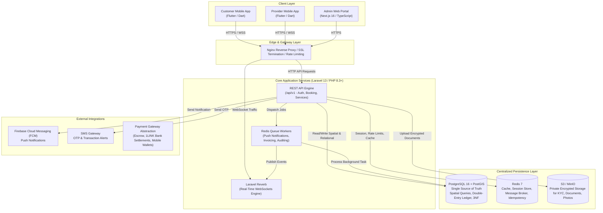

# KAAMLY PLATFORM – SYSTEM ARCHITECTURE SPECIFICATION (REVISED)

## 1. Executive Summary & Platform Overview

**Kaamly** is an enterprise-grade, multi-sided on-demand service marketplace platform connecting customers with vetted local service providers (electricians, plumbers, HVAC technicians, carpenters, appliance repair, beauty services, cleaners, and more).

The platform comprises three distinct user-facing applications communicating with a single, high-performance, centralized backend:

1. **Kaamly Customer Mobile App** (Flutter / Dart for iOS & Android)
2. **Kaamly Service Provider Mobile App** (Flutter / Dart for iOS & Android)
3. **Kaamly Admin Web Portal** (Next.js 16 / React 19 / TypeScript / Tailwind CSS)
4. **Kaamly Core API & Real-time Engine** (Laravel 13 REST API, PHP 8.3/8.4, PostgreSQL 16 with PostGIS, Redis 7, Laravel Reverb WebSockets)

---

## 2. High-Level Architecture Diagram

---

## 3. Technology Stack Justification

| Layer | Selected Tech | Justification |
| :--- | :--- | :--- |
| **Relational Database** | **PostgreSQL 16 + PostGIS** | Robust ACID transactions for double-entry financial ledgers, native spatial indexing (`GIST`) for finding providers within a geographic radius in sub-millisecond speeds. Single source of truth. |
| **Backend API Framework**| **Laravel 13 (PHP 8.3+)** | Modern PHP features, Eloquent ORM, robust migration engine, native Sanctum authentication, job queues, event broadcasting, and strict type safety. |
| **Real-time Server** | **Laravel Reverb** | High-concurrency WebSocket server built directly for Laravel, eliminating Node.js microservice fragmentation while handling thousands of live socket connections for chat and tracking. |
| **In-Memory Cache & Queue**| **Redis 7** | Fast transient state handling, distributed locking for financial transactions to prevent double-spending, and queue execution. |
| **Admin Web Portal** | **Next.js 16 (React 19 & TS)**| Server-Side Rendering (SSR), server components, type-safe API consumption, responsive dashboards with Tailwind CSS. |
| **Mobile Applications** | **Flutter 3.x & Dart** | Shared architectural libraries between Customer and Provider apps (models, API interceptors, WebSockets) while maintaining distinct UX, theme, and navigation paradigms. |
| **Object Storage** | **S3-compatible (MinIO / AWS)**| Standardized private bucket storage for CNIC, police verification documents, trade certificates, and job proof photos with 15-min pre-signed URLs. |

---

## 4. Multi-Tenant Role-Based Access Control (RBAC)

The system supports unified user identity with granular roles:

* **Customer**: Can browse services, request quotes, confirm bookings, chat, and rate providers.
* **Provider**: Can submit credentials, propose service prices, receive job leads, submit quotes, update job status, and view wallet earnings.
* **Admin / Operations**: Full access to verify providers, set market rate limits, adjust prices, inspect chats for safety, arbitrate disputes, and manage platform commission payouts.

---

## 5. Comprehensive Booking Lifecycle & State Machine

13 distinct, server-enforced statuses:
1. `pending`
2. `broadcasted`
3. `accepted`
4. `quotation_submitted`
5. `awaiting_customer_confirmation`
6. `confirmed`
7. `provider_on_the_way`
8. `in_progress`
9. `completed`
10. `cancelled`
11. `disputed`
12. `rescheduled`
13. `no_show`

Full state transition rules, cancellation fees, rescheduling, and no-show protocols are detailed in [docs/architecture/booking_state_machine.md](file:///d:/Study/code/Kaamly/docs/architecture/booking_state_machine.md).

---

## 6. Financial Architecture & Double-Entry Ledger

All monetary movements are governed by `ledger_accounts`, `ledger_transactions`, and `ledger_entries` ensuring:
$$\sum \text{Debit} = \sum \text{Credit}$$

Comprehensive accounting entries for Cash On Delivery (COD), Online Escrow, Provider Commission Receivables, Bank Settlements, and Dispute Awards are specified in [docs/architecture/financial_ledger_accounting.md](file:///d:/Study/code/Kaamly/docs/architecture/financial_ledger_accounting.md).

---

## 7. Geospatial Discovery Engine (PostGIS)

Location searches use PostgreSQL's native PostGIS `ST_DWithin` with 6 simultaneous gates (Proximity, Live Status, Location Freshness $\le 30$ mins, Active Approved Pricing within Market Bounds, Shift Availability, and Booking Conflict Exclusion). Details in [docs/architecture/spatial_discovery_engine.md](file:///d:/Study/code/Kaamly/docs/architecture/spatial_discovery_engine.md).

---

## 8. Security & Governance Protocols

1. **Sensitive Data Encryption**: AES-256-GCM application-level encryption for CNIC and bank account details.
2. **Private Document Storage**: S3 private buckets with 15-minute temporary pre-signed URLs.
3. **Audit Logging**: Immutable `audit_logs` storing actor, IP, user_agent, action, and JSONB before/after deltas.
4. **Financial Adjustment Controls**: Maker-Checker dual authorization for adjustments exceeding PKR 10,000.
Full details in [docs/architecture/security_governance_controls.md](file:///d:/Study/code/Kaamly/docs/architecture/security_governance_controls.md).
