# KAAMLY PLATFORM – REVISED ENTITY-RELATIONSHIP (ER) DIAGRAM

The revised ER diagram below incorporates all 11 core functional domains, the completed sub-domains (`booking_requests`, `quotation_items`, `payment_attempts`, `settlement_items`, `disputes`, `conversation_participants`, `provider_availability_exceptions`), and the **Double-Entry General Ledger** (`ledger_accounts`, `ledger_transactions`, `ledger_entries`).

```mermaid
erDiagram
    users ||--o{ user_roles : has
    roles ||--o{ user_roles : assigned_to
    roles ||--o{ role_permissions : grants
    permissions ||--o{ role_permissions : belongs_to
    
    users ||--o| customer_profiles : "1-to-1 customer"
    users ||--o| provider_profiles : "1-to-1 provider"
    users ||--o{ ledger_accounts : owns_wallet_account
    
    customer_profiles ||--o{ customer_addresses : registers
    customer_profiles ||--o{ bookings : requests
    
    provider_profiles ||--o{ provider_documents : submits
    provider_profiles ||--o{ provider_bank_accounts : links
    provider_profiles ||--o{ provider_services : provides
    provider_profiles ||--o{ provider_working_hours : configures
    provider_profiles ||--o{ provider_day_off_schedules : takes
    provider_profiles ||--o{ provider_availability_exceptions : overrides
    provider_profiles ||--o{ provider_service_zones : covers
    provider_profiles ||--o{ bookings : executes
    provider_profiles ||--o{ booking_requests : receives
    provider_profiles ||--o{ settlements : withdraws
    
    service_categories ||--o{ services : classifies
    services ||--o{ provider_services : maps_to
    provider_services ||--o{ provider_service_prices : proposes
    service_areas ||--o{ provider_service_zones : maps_to
    
    bookings ||--o{ booking_requests : broadcasts
    bookings ||--o{ booking_items : contains
    bookings ||--o{ quotations : receives
    quotations ||--o{ quotation_items : details
    bookings ||--o{ booking_status_history : tracks
    bookings ||--o{ booking_attachments : attaches
    bookings ||--o| reviews : receives
    bookings ||--o| disputes : arbitrates
    bookings ||--o{ payment_attempts : attempts
    bookings ||--o{ ledger_transactions : triggers
    
    conversations ||--o{ conversation_participants : includes
    conversations ||--o{ messages : contains
    messages ||--o{ message_attachments : attaches
    
    ledger_transactions ||--o{ ledger_entries : balances
    ledger_accounts ||--o{ ledger_entries : posts_to
    settlements ||--o{ settlement_items : aggregates
    ledger_entries ||--o{ settlement_items : links

    users {
        uuid id PK
        varchar phone_number UK
        varchar email UK
        enum user_type
        enum status
        timestamptz created_at
    }

    customer_profiles {
        uuid id PK
        uuid user_id FK
        uuid default_address_id FK
        numeric total_spent
        numeric rating_as_customer
    }

    provider_profiles {
        uuid id PK
        uuid user_id FK
        enum verification_status
        boolean is_online
        geography current_location
        timestamptz location_updated_at
        numeric service_radius_km
        numeric rating_average
    }

    services {
        uuid id PK
        uuid category_id FK
        varchar name
        enum pricing_type
        numeric market_rate_min
        numeric market_rate_max
    }

    bookings {
        uuid id PK
        varchar booking_number UK
        uuid customer_profile_id FK
        uuid provider_profile_id FK
        uuid service_id FK
        uuid address_id FK
        enum status
        enum payment_method
        enum payment_status
        date scheduled_date
        varchar scheduled_time_slot
        numeric agreed_base_price
        numeric total_amount
        numeric provider_earning
        numeric platform_commission
        geography service_location
    }

    ledger_accounts {
        uuid id PK
        varchar account_number UK
        varchar name
        enum account_type
        uuid user_id FK
        boolean is_system
    }

    ledger_transactions {
        uuid id PK
        varchar transaction_number UK
        uuid booking_id FK
        varchar reference_type
        enum status
        varchar idempotency_key UK
        timestamptz posted_at
    }

    ledger_entries {
        uuid id PK
        uuid transaction_id FK
        uuid account_id FK
        varchar entry_type
        numeric amount
        text memo
    }

    disputes {
        uuid id PK
        varchar dispute_number UK
        uuid booking_id FK
        uuid raised_by_user_id FK
        uuid against_user_id FK
        varchar dispute_reason
        numeric claimed_amount
        numeric awarded_refund_amount
        numeric awarded_provider_payout
        enum status
    }
```

