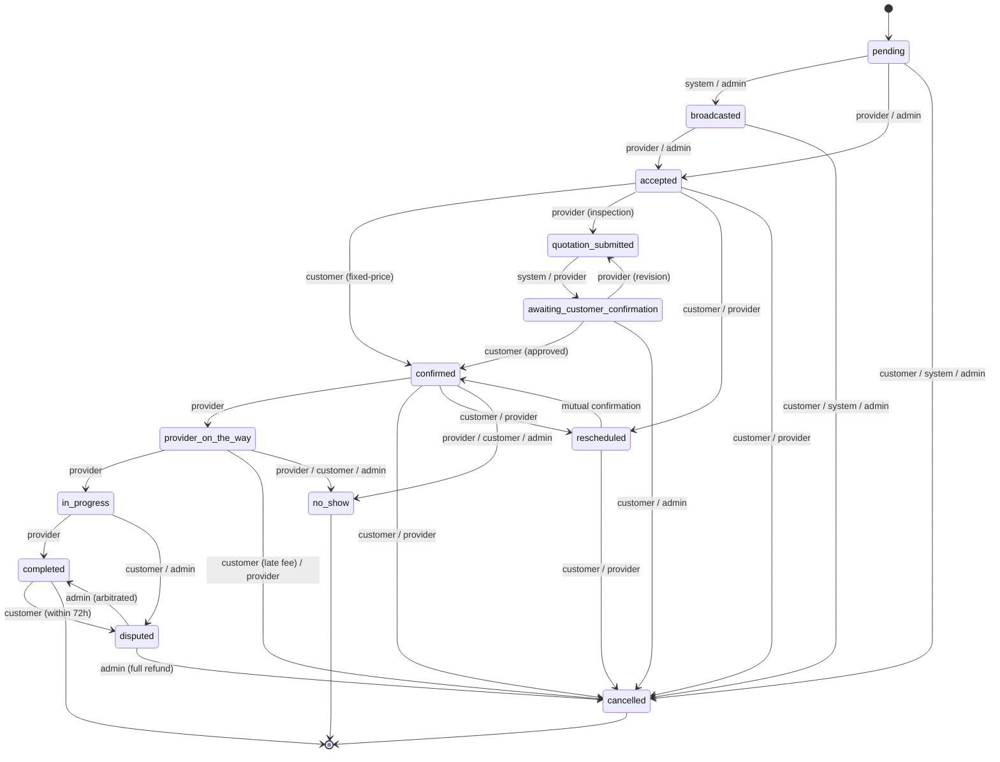

# Kaamly – Booking Lifecycle & State Machine Audit Report

**Date**: November 17, 2026  
**Auditor**: Antigravity Principal Architecture & QA Agent  
**Environment**: Laravel 13 State Machine & Lifecycle Service  
**Report Type**: 13-State Transition Matrix, Inspection Engine, and Edge-Case Handling

---

## 1. 13-State Lifecycle Transition Matrix

---

## 2. Permitted Transitions & Authorization Rules

| Current Status | Target Status | Authorized Actors | Required Conditions | Financial Impact |
| :--- | :--- | :--- | :--- | :--- |
| `pending` | `broadcasted` | `system`, `admin` | Service is broadcastable | None |
| `pending` | `accepted` | `provider`, `admin` | Provider debt < PKR 2,000 | None |
| `broadcasted` | `accepted` | `provider`, `admin` | First to accept reserves slot | None |
| `accepted` | `confirmed` | `customer`, `admin` | Fixed-price service confirmed | Escrow captured (if online) |
| `accepted` | `quotation_submitted`| `provider` | Inspection visit complete | None |
| `quotation_submitted` | `awaiting_customer_confirmation` | `system`, `provider` | Line items calculated | None |
| `awaiting_customer_confirmation` | `confirmed` | `customer`, `admin` | Quote unexpired and active | Agreed price locked, escrow captured |
| `confirmed` | `provider_on_the_way` | `provider` | Within travel window | None |
| `provider_on_the_way` | `in_progress` | `provider` | Arrival GPS logged | None |
| `in_progress` | `completed` | `provider`, `admin` | Completion evidence uploaded | Escrow released / COD recognized |
| `in_progress` / `completed` | `disputed` | `customer`, `admin` | Within 72-hour window | Escrow frozen; payout blocked |
| `disputed` | `completed` | `admin` | Arbitration agreement | Partial refund + partial payout |
| `accepted` / `confirmed` | `rescheduled` | `customer`, `provider` | Future time proposed | Slot hold updated |
| `rescheduled` | `confirmed` | `customer`, `provider` | Mutual consent, GiST check | Primary schedule updated |
| Any active | `cancelled` | `customer` (pre-dispatch) | Before technician leaves | 100% full escrow refund |
| `provider_on_the_way` | `cancelled` | `customer` (post-dispatch)| Technician en route | PKR 500 travel fee to provider |
| `accepted` / `confirmed` | `cancelled` | `provider` (unexcused) | Provider cancels job | PKR 300 penalty debt to provider |
| `confirmed` | `no_show` | `provider` (customer no-show)| Wait $\ge$ 20m, $\ge$ 2 calls | PKR 500 travel fee to provider |
| `confirmed` | `no_show` | `customer` (provider no-show)| Provider late > 60m | 100% refund, PKR 500 provider penalty |

---

## 3. Inspection Quotation Lifecycle Verification

1. **Versioning**: Technician can submit multiple revisions during an inspection visit. Submitting Version $N+1$ marks Version $N$ as `superseded`.
2. **Expiry**: Quotations have a default 24-hour expiration window (`expires_at = now() + 24 hours`).
3. **Acceptance Integrity**:
   - Accepting Version $N$ when Version $N+1$ exists $\rightarrow$ **REJECTED** (`This quotation has been superseded by a newer version`).
   - Accepting an expired quotation $\rightarrow$ **REJECTED** (`Quotation has expired`).
   - Accepting the active unexpired quotation $\rightarrow$ Locks `agreed_total_price` snapshot in the booking, transitions status to `confirmed`, and captures escrow.

---

## 4. Prohibited Transition Negative Tests
- Attempting transition from terminal `cancelled` to `confirmed` $\rightarrow$ **BLOCKED**.
- Attempting transition from terminal `no_show` to `in_progress` $\rightarrow$ **BLOCKED**.
- Customer attempting to mark job `completed` $\rightarrow$ **BLOCKED**.
- Provider attempting to confirm booking without customer approval $\rightarrow$ **BLOCKED**.
